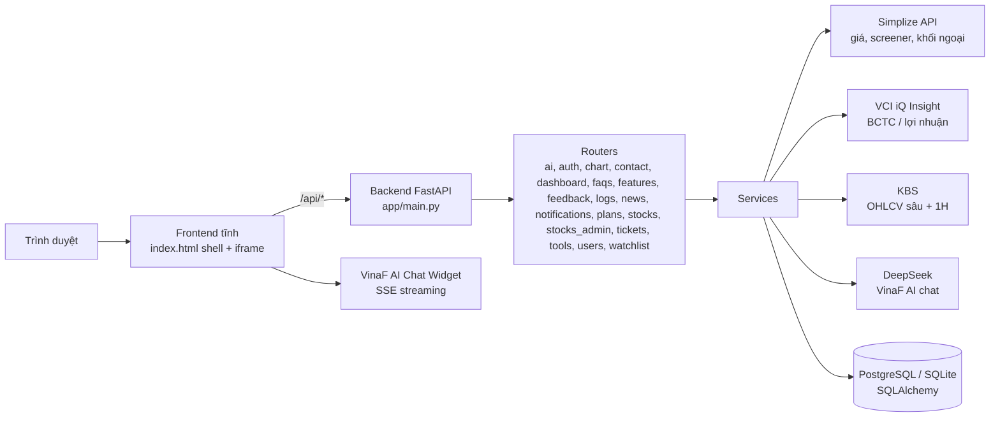

# VinaFintech — Tài liệu Đặc tả (Specification)

> Phiên bản: 1.0 · Cập nhật: 2026-08-16 · Mục đích: mô tả kiến trúc, tính năng, API và nguồn dữ liệu của hệ thống VinaFintech.

---

## 1. Tổng quan

**VinaFintech** là nền tảng **phân tích cổ phiếu Việt Nam** (HOSE/HNX/UPCoM) gồm:

- **Trang chủ / Thị trường**: tổng quan chỉ số (VNINDEX, VN30, HNX, HNX30, UPCOM, Dow Jones, Bitcoin, vàng thế giới, vàng trong nước), bộ lọc cổ phiếu, tin tức.
- **Trang chi tiết cổ phiếu** (`/cophieu-{MÃ}`): biểu đồ nến chuyên sâu, sổ lệnh, giao dịch gần nhất, so sánh tương quan, phân tích lợi nhuận, cơ cấu cổ đông, báo cáo, giả định tích sản.
- **VinaF AI**: trợ lý AI chat (DeepSeek + Tool Calling) với các tool lấy dữ liệu thị trường, cổ phiếu, tin tức.
- **Tin tức**, hỗ trợ (ticket, FAQ, góp ý), tài khoản/đăng nhập (JWT + OAuth Google), quản trị (admin).
- **Watchlist** theo dõi cổ phiếu, thông báo.

Kiến trúc: **Backend FastAPI (Python) phục vụ JSON API + Frontend tĩnh (HTML/JS/CSS)** — frontend dùng `index.html` làm shell, nội dung các trang lớn (Home.html, StockDetail.html, tin-tuc.html, tintuc.html, caidat.html, taikhoan.html, doimatkhau.html) nhúng bằng `<iframe>` để giữ nguyên CSS/JS của từng trang.

---

## 2. Kiến trúc tổng thể



- **SPA-like**: điều hướng trong trang bằng `loadContent()`; URL đẹp qua `history.replaceState` (`/cophieu-{MÃ}`, `/tin-tuc`, `/chung-khoan`, `/ngan-hang`, `/bat-dong-san`, `/doanh-nghiep`, `/dong-tien-thong-minh`, `/tai-chinh-quoc-te`, `/cong-nghe`, `/tien-ao` (Crypto), `/{slug}-{id}.html`).
- **Embedded pages (iframe)**: `Home.html`, `StockDetail.html`, `tin-tuc.html`, `caidat.html`, `taikhoan.html`, `doimatkhau.html`.
- **Fullscreen chart**: icon nến ở header → parent fullscreen iframe (`requestFullscreen` trong cử chỉ click) → 1 click vào fullscreen trên mọi trình duyệt.

---

## 3. Công nghệ / Tech Stack

| Thành phần | Công nghệ |
|---|---|
| Backend | Python 3.10+, **FastAPI**, Uvicorn |
| ORM | SQLAlchemy |
| DB | PostgreSQL (prod/Render) · SQLite (dev) |
| Cấu hình | Pydantic Settings (`.env`) |
| Auth | JWT (access + refresh), OAuth Google, rate-limit đăng nhập |
| Frontend | HTML/CSS/JS tĩnh, Font Awesome 6, không framework build |
| Chart | TradingView **Lightweight Charts** v5.2.1 (vendor) |
| AI | **DeepSeek** (`deepseek-chat`) + tool calling (httpx) |
| Data | Simplize, VCI iQ, KBS (KB Securities) |
| Deploy | **Render** (blueprint `render.yaml`, autoDeploy từ `main`) |

---

## 4. Cấu trúc thư mục

```
VinaFintech/
├── main.py                    # entrypoint: from app.main import app
├── render.yaml                # Render blueprint (web + Postgres)
├── requirements.txt
├── AGENTS.md                  # Vnstock vibe-coding onboarding
├── app/
│   ├── main.py                # FastAPI app, routers, static mount, PAGE_MAP
│   ├── config.py              # Settings (.env)
│   ├── security.py            # JWT encode/decode
│   ├── dependencies.py        # get_current_user, get_optional_user, require_roles (get_db từ app.db)
│   ├── db.py / db_schema.py   # engine, session, schema bootstrap
│   ├── models.py              # SQLAlchemy models (users, social_accounts, user_delete_requests, revoked_tokens, password_reset_tokens, news, support_tickets, support_replies, faqs, contact_messages, feedback, plans, features, settings, logs, watchlist, notification_reads, notifications, system_announcements, stock_symbols)
│   ├── routers/               # API routers (17 module)
│   │   ├── ai.py  auth.py  chart.py  contact.py  dashboard.py  faqs.py
│   │   ├── features.py  feedback.py  logs.py  news.py  notifications.py
│   │   ├── plans.py  stocks.py  stocks_admin.py  tickets.py  tools.py
│   │   ├── users.py  watchlist.py
│   └── services/
│       ├── vnstock_service.py # data layer (Simplize/VCI/KBS), SimpleTTLCache
│       ├── chart_service.py   # chart history / index chart / config
│       ├── ai_service.py      # VinaF AI: chat, tools, market insight
│       ├── email_service.py   # SMTP (gửi email reset mật khẩu)
│       └── oauth_service.py   # Google OAuth
├── frontend/
│   ├── index.html             # shell chính (header, ticker, chat widget, iframe)
│   ├── Home.html, StockDetail.html, tin-tuc.html, tintuc.html
│   ├── Login/register/forgot-password/reset-password
│   ├── caidat/taikhoan/doimatkhau, QuanTri, AdminLogin
│   ├── Trang hỗ trợ: TrungTamTroGiup, HuongDanSuDung, CauHoiThuongGap,
│   │                   LienHe, GopY, DieuKhoanSuDung, ChinhSachBaoMat, MienTruTrachNhiem
│   └── assets/
│       ├── chart/             # chart engine module (core, data, indicators, drawings, analysis, compare, ui)
│       ├── vendor/            # lightweight-charts.standalone.production.js
│       ├── tradingview/       # (để dành) Advanced Charts — chưa dùng
│       └── Logo/ admin.js app.js header-search.js theme-instant.js theme-instant.css styles.css support-legal.css typography.css chart/ tradingview/ vendor/
├── scripts/                   # create_superadmin.py, import_markettimes_news.py, migrate_to_render.py, push_news_to_render.py
└── .cache/                    # cache JSON của Simplize (symbol_directory.json, symbol_summaries.json, symbol_screener.json, symbol_dividends.json, symbol_business.json)
```

---

## 5. Cơ sở dữ liệu (models)

Các bảng chính trong `app/models.py`:

| Bảng | Mô tả |
|---|---|
| `users` | Người dùng (role: super_admin/admin/content_manager/editor/support/user) |
| `social_accounts` | Tài khoản OAuth (Google) |
| `user_delete_requests` | Yêu cầu xoá tài khoản |
| `revoked_tokens` | Token đã thu hồi |
| `password_reset_tokens` | Token reset mật khẩu |
| `news` | Bài tin tức (status: pending-approval, approved, published, rejected) |
| `support_tickets` / `support_replies` | Hỗ trợ người dùng |
| `faqs` | Câu hỏi thường gặp |
| `contact_messages` | Liên hệ |
| `feedback` | Góp ý |
| `plans` / `features` | Gói & tính năng (kiểm soát tính năng theo key + access_level theo gói, ví dụ: ai_chat) |
| `settings` | Cấu hình hệ thống |
| `logs` | Nhật ký |
| `watchlist` | Theo dõi cổ phiếu |
| `notifications` / `notification_reads` / `system_announcements` | Thông báo |
| `stock_symbols` | Mã cổ phiếu admin thêm thủ công (ví dụ: mã IPO mới chưa có trên 3 sàn) |

---

## 6. API (Routers) — prefix `/api`

| Router | Nhóm endpoint chính |
|---|---|
| `stocks` | `/stocks/search`, `/{sym}/quote`, `/history`, `/financials`, `/insider-trades`, `/shareholders`, `/reports`, `/dividends`, `/company-summary`, `/order-book`, `/trades`, `/money-flow`, `/peers`, `/profit-analysis`, `/financial-statement`, `/indices`, `/market-overview`, `/index-detail`, `/market-map`, `/realtime-board`, `/foreign-trading`, `/watchlist` |
| `chart` | `/chart/history`, `/chart/config`, `/chart/search`, `/chart/quote`, `/chart/server-time` |
| `ai` | `/ai/status`, `/ai/chat` (SSE) |
| `auth` | đăng nhập/đăng ký/refresh/oauth/reset mật khẩu |
| `users` | hồ sơ, đổi mật khẩu, xoá tài khoản |
| `news` / `tickets` / `contact` / `feedback` / `faqs` / `plans` / `features` | nội dung & hỗ trợ |
| `dashboard` / `logs` | admin |
| `stocks_admin` | quản lý mã cổ phiếu |
| `notifications` / `watchlist` | thông báo & theo dõi |
| `tools` | công cụ trợ giúp (viết bài/import JSON, quản lý mã cổ phiếu IPO) |

> Bảo vệ khu vực `/QuanTri`: middleware chặn (404) nếu không phải admin/support.

---

## 7. Nguồn dữ liệu

| Nguồn | Dùng cho | Ghi chú |
|---|---|---|
| **Simplize** (`api2.simplize.vn`) | giá realtime, lịch sử, screener, khối ngoại, độ rộng, directory | `SimpleTTLCache` theo key; quote 15s, foreign 90s, board 10s |
| **VCI iQ** (`iq.vietcap.com.vn`) | BCTC / lợi nhuận quý (phân tích lợi nhuận) | cache 6h |
| **KBS** (`kbbuddywts.kbsec.com.vn`) | OHLCV sâu ~10 năm + intraday **1H** | data TTL 60s, earliest 1h |
| **DeepSeek** | VinaF AI chat (tool calling) | cần `DEEPSEEK_API_KEY` |
| **File cache** (`.cache/*.json`) | symbol_directory, symbol_summaries (24h), screener, dividends, business | tồn tại trên đĩa |

**Cache**: `SimpleTTLCache` (in-memory, dict) + file cache JSON cho dữ liệu nặng.

---

## 8. Frontend — shell & điều hướng

- `index.html` là shell: header (logo, tìm kiếm, icon nến fullscreen, thông báo, theme, tài khoản), nav tin tức, **VinaF AI chat widget** (SSE), footer.
- `loadContent(page)`:
  - Trang **embedded** (Home.html, StockDetail.html, tin-tuc.html, tintuc.html, caidat.html, taikhoan.html, doimatkhau.html) → dựng `<iframe id="contentEmbedFrame">` (cache-bust `?v=Date.now()`), điều chỉnh chiều cao qua `postMessage` (`tunix-embed-height`).
  - Trang khác (TrungTamTroGiup, HuongDanSuDung, CauHoiThuongGap, LienHe, GopY, DieuKhoanSuDung, ChinhSachBaoMat, MienTruTrachNhiem) → `fetch` + `DOMParser` nhúng nội dung.
- Giao tiếp parent ⇄ iframe qua `postMessage`: `tunix-switch-stock`, `tunix-open-stock`, `tunix-symbol-changed`, `tunix-embed-height`, `tunix-home-height`, `tunix-set-theme`, `tunix-open-tintuc`, `tunix-open-url`, `tunix-cat-changed`, `tunix-search-clear`, `tunix-user-updated`, `tunix-stock-modal`.
- **Đổi theme tức thì** (`assets/theme-instant.js` + `theme-instant.css`, nhúng ở mọi trang): MutationObserver theo dõi class `dark-mode` trên `<body>`, bật class `theme-switching` trên `<html>` trong đúng lúc chuyển theme để tắt toàn bộ `transition` ⇒ nền/viền/chữ đổi màu ngay và đồng bộ giữa các lớp (không còn fade 0.3s lệch với ô sticky/header bảng). Hiệu ứng hover/animation ngoài lúc chuyển theme giữ nguyên.
- URL đẹp: `/cophieu-{MÃ}`, `/tin-tuc`, `/{chuyên-mục}`, `/{slug}-{id}.html`.

---

## 9. Trang chi tiết cổ phiếu (`StockDetail.html`)

Các block (tải song song, chart render sớm không chờ quote):

1. **Thông tin cơ bản** — giá, % thay đổi, nút yêu thích.
2. **Chỉ số cơ bản** — vốn hoá, P/E, P/B, EPS, ROE, ROA, KLGD TB, %1W/1M/YTD.
3. **Biểu đồ nến** — Lightweight Charts, timeframe 1H/1D/1W/1M, chỉ báo (SMA/EMA/RSI/MACD/BB), drawings, so sánh, phân tích, export PNG, fullscreen.
4. **Sổ lệnh** + **So sánh tương quan** (click mã → chuyển sang mã đó). Block Sổ lệnh có 2 tab: **Sổ lệnh** (giữ nguyên) và **Dòng tiền** — dòng tiền ròng **10 phiên** tính từ OHLCV (`/stocks/{symbol}/money-flow`): giá trị giao dịch (giá TB × KL) tách thành tiền vào/ra theo hệ số CLV `((C−L)−(H−C))/(H−L)`; hiển thị 3 KPI (vào / ra / ròng) + biểu đồ cột phân kỳ (xanh = vào, đỏ = ra). VCI/SSI không có lịch sử mua/bán chủ động theo phiên nên số liệu là ước lượng từ biến động giá, không phải giá trị mua/bán chủ động.
5. **Giao dịch gần nhất** — tải dần theo cursor `before`: cuộn xuống để tự nạp thêm các lệnh khớp cũ hơn của phiên (VCI trả tối đa 100 lệnh/request nên phải phân trang). Khung bảng cao vừa đúng **14 dòng** (header 22px + 14 × 27px = 400px) để lấp kín chiều cao block.
6. **Kết quả kinh doanh** | **Cân đối kế toán** (2 block cạnh nhau, đặt ngay trên block Phân tích lợi nhuận) — bảng BCTC đầy đủ mọi chỉ tiêu từ `/stocks/{symbol}/financial-statement` (VCI iQ): chọn 4 quý / 8 quý / 4 năm, đơn vị tỷ đồng, kỳ mới nhất bên trái, chỉ tiêu tổng hợp in đậm, cuộn trong khung.
7. **Phân tích lợi nhuận** (biểu đồ cột theo quý, nguồn VCI).
8. **Cơ cấu cổ đông**.
9. **Giả định tích sản 5 năm** (DCA 5tr/tháng vs ngân hàng, ô nhập số tuỳ chỉnh).
10. **Báo cáo** (tài chính, thường niên, phân tích, nghị quyết, bản cáo bạch).

- Hỗ trợ **mã chỉ số** (VNINDEX, VN30, HNX, HNXINDEX, HNX30, UPCOM, UPINDEX, UPCOMM): ẩn các block không có dữ liệu (sổ lệnh, giao dịch gần nhất, so sánh tương quan, kết quả kinh doanh/cân đối kế toán, phân tích lợi nhuận, cơ cấu cổ đông, báo cáo, tích sản).
- **Fullscreen** (`?fs=1`): parent-driven; thoát fullscreen trả chart về chiều cao bình thường, icon nến fullscreen đúng mã đang xem, thoát từ trang không phải chi tiết thì quay lại trang trước.
- **Dashboard fullscreen** (`.chart-bottom`): **Giả định tích sản 5 năm** · **Dòng tiền 10 phiên** (cùng nguồn `/stocks/{symbol}/money-flow`: ròng 10 phiên + cột vào/ra, có tooltip từng phiên) · **VinaF AI phân tích**. Panel Dòng tiền thay cho panel Tin tức nổi bật trước đây.

---

## 10. VinaF AI

### 10.1 Chat (DeepSeek + Tool Calling)
- `POST /api/ai/chat` (cần đăng nhập + rate limit + gói): vòng lặp tool-calling, trả `{reply, tool_calls}` hoặc stream SSE (`/ai/chat?stream`).
- **19 tool**:
  - Cổ phiếu: `search_stocks`, `get_quote`, `get_history`, `get_financials`, `get_insider_trades`, `get_shareholders`, `get_reports`, `get_dividends`, `get_peers`, `get_profit_analysis`, `get_recent_trades`.
  - Thị trường: `get_market_overview`, `get_top_stocks`, `get_foreign_trading`, `get_realtime_board`, `filter_stocks`, **`get_market_flow`** (mới).
  - Tin tức: `search_news`, `get_news_detail`.
- System prompt bắt buộc: dùng tool lấy dữ liệu thật, không bịa số liệu, trả lời tiếng Việt, không khuyến nghị mua/bán cụ thể.

---

## 11. Chart Engine (module)

Thư mục `frontend/assets/chart/`:

| Module | Chức năng |
|---|---|
| `stockDetailChart.js` | Controller chính, API `{load, setTimeframe, setTheme, destroy, resetChartHeight}` |
| `core/` | `chartEngine`, `chartState`, `chartEvents`, `fullscreen`, `paneResizer`, `crosshairSync`, `hotkeys`, `persistence`, `lastPriceLine`, `historyLoader` |
| `data/` | `dataProvider`, `dataNormalizer`, `dataCache` |
| `indicators/` | bộ chỉ báo kỹ thuật |
| `drawings/` | vẽ hình (đường xu hướng, văn bản, mũi tên, Fib/FibX, hình chữ nhật, vùng S/R) |
| `analysis/` | phân tích + confluence |
| `compare/` | so sánh mã |
| `ui/` | legend, toolbar, panels (chỉ báo/phân tích/cài đặt/so sánh) |

---

## 12. Deploy

- **Render** (`render.yaml`): web service `VinaFintech` + Postgres `Tunix-test1-db` (region Singapore), `autoDeploy: true` khi push `main`.
- `buildCommand: pip install -r requirements.txt`, `startCommand: uvicorn main:app --host 0.0.0.0 --port $PORT`.
- Env: `APP_ENV=production`, `SECRET_KEY` (tự sinh), `DATABASE_URL` (từ DB), `FRONTEND_URL=https://tunix.onrender.com`, `DEEPSEEK_API_KEY` (set thủ công).
- Scripts: `migrate_to_render.py`, `push_news_to_render.py`, `create_superadmin.py`.

---

## 13. Hiệu năng & tối ưu (đã áp dụng)

- `get_quote` chạy **song song** 3 request mạng (giá/lịch sử/chỉ số cơ bản) qua `ThreadPoolExecutor`.
- Chart + các panel (sổ lệnh, giao dịch, so sánh) tải **song song với quote**; chart render sớm không chờ quote chậm.
- Cache đa tầng: in-memory TTL + file cache JSON; chỉ số cơ bản cache 24h.
- Ticker VinaF AI cache 5 phút; board best-effort có timeout.

---

## 14. Ghi chú / lưu ý vận hành

- Server dev dùng SQLite; prod Render dùng PostgreSQL (migrate qua `migrate_to_render.py`).
- `import vnstock` có thể treo trên môi trường cũ — dữ liệu hiện không phụ thuộc vnstock (dùng Simplize/VCI/KBS trực tiếp).
- File tĩnh JS có thể bị cache trình duyệt — khi sửa frontend nên F5/clear cache khi test.
- `frontend/assets/tradingview/` là code **để dành** (chưa dùng; chart hiện dùng lightweight-charts).
